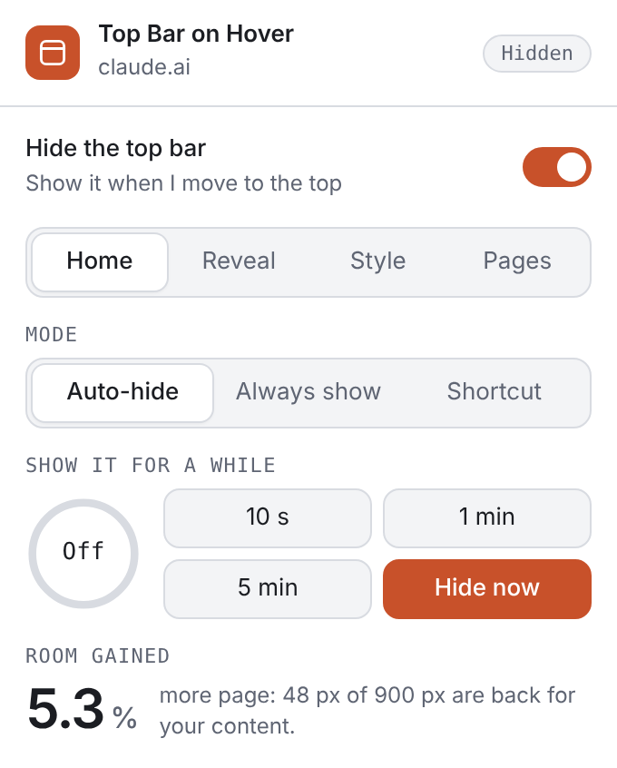
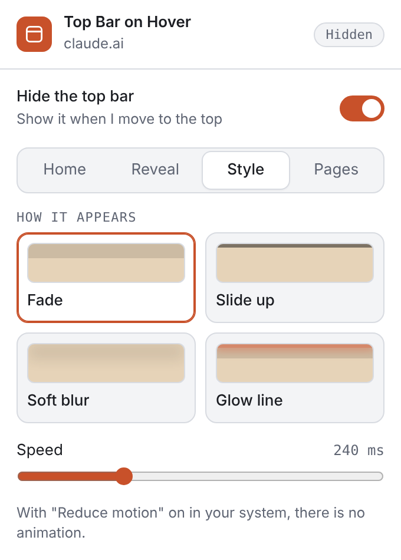

# Claude Top Bar on Hover

Hide the top bar on [claude.ai](https://claude.ai). Move the mouse to the top and it comes back.
You get the whole window for your chat or artifact, and the bar is one mouse move away.

Works in Chrome, other Chromium browsers (Edge, Brave, Dia) and Firefox. No data collected, no network requests.

**[Get it for Firefox](https://addons.mozilla.org/en-US/firefox/addon/claude-top-bar-on-hover/)** ·
**[Download for Chrome / Chromium](https://github.com/GHOST-DEKU/claude-top-bar-hover/releases/latest/download/claude-top-bar-hover-chrome.zip)** ·
[All releases](https://github.com/GHOST-DEKU/claude-top-bar-hover/releases)

<p align="center">
<picture><source media="(prefers-color-scheme: dark)" srcset="website/static/screenshots/popup-home-dark.png"></picture>
<picture><source media="(prefers-color-scheme: dark)" srcset="website/static/screenshots/popup-style-dark.png"></picture>
</p>

## Contents

[Features](#features) · [The popup](#the-popup) · [Install](#install) · [FAQ](#faq) · [Troubleshooting](#troubleshooting) · [How it works](#how-it-works) · [Known limits](#known-limits) · [Releases](#making-a-release) · [License](#license)

## Features

- **Hover to show.** Move the mouse to the top and the bar fades in (fast). Move away and it fades out
  after a short pause, so a quick slip of the mouse does not make it flicker.
- **Four ways to appear.** Fade, slide up, soft blur or glow line (see [the popup](#the-popup)).
- **No empty strip.** On pages where the bar takes up space (for example an artifact opened from inside
  Claude), the page moves up to fill the window and the bar floats over it when shown.
- **Artifacts opened from a chat.** The viewer panel there has its own title bar (title, Copy, Share,
  close). It is hidden and shown the same way as the main bar.
- **Sidebar button included.** The collapsed-sidebar button hides and shows together with the bar.
- **Stays up when you need it.** The bar stays visible while one of its menus is open (for example the
  title menu) and while you move through it with the keyboard (Tab or the arrow keys).
- **Peek and shortcut.** Show the bar for 10 s, 1 min or 5 min, or press **Alt + B** to show or hide it.
- **Careful with the page.** Clicks still reach whatever is under the mouse. Focus that the page itself
  sets does not pin the bar open. Touch screens (no hover) are left alone. "Reduce motion" is respected.
- **Private.** No data collected, no network requests. It only runs on `https://claude.ai/*`, and the
  only permission it asks for is `storage` (your settings stay in your browser).

## The popup

Click the extension icon. The switch at the top turns the whole extension on or off. Four tabs:

| Tab | What you can set |
|---|---|
| **Home** | Mode (Auto-hide, Always show, Shortcut only). A **peek timer** that keeps the bar shown for 10 s, 1 min or 5 min. **Room gained**: how much more page you see, from the real bar and window height. |
| **Reveal** | Where the mouse must go: whole top, left corner or right corner. Zone height, wait before showing, wait before hiding. |
| **Style** | How the bar appears: fade, slide up (no fade: the contents slide out of the window), soft blur (it blurs first, then fades) or glow line (a glowing orange line stays at the top while the bar is hidden). The sidebar button follows the same style. Speed. Picking a style or a speed shows the bar for a moment so you see it. |
| **Pages** | Turn hiding on or off for Chats, Artifacts and Projects separately. Reset all. |

The icon shows a small badge: the time left while the peek timer runs, or "off" while the extension is
switched off. **Alt + B** shows or hides the bar (press again to hide). You can change the key in
`chrome://extensions/shortcuts` (Firefox: Add-ons Manager, gear icon, Manage Extension Shortcuts).

## Install

### Firefox

Install it from the [Firefox Add-ons page](https://addons.mozilla.org/en-US/firefox/addon/claude-top-bar-on-hover/).

### Chrome, Edge, Brave, Dia (any Chromium browser)

1. Download [the Chrome zip](https://github.com/GHOST-DEKU/claude-top-bar-hover/releases/latest/download/claude-top-bar-hover-chrome.zip)
   and unzip it into its own folder. Keep the folder: the browser reads the extension from it.
2. Open the extensions page (`chrome://extensions`, or the same page of your browser).
3. Turn on **Developer mode**.
4. Click **Load unpacked** and choose the folder from step 1.
5. Refresh your Claude tab.

### From source

You need `bash` and `zip`.

```bash
git clone https://github.com/GHOST-DEKU/claude-top-bar-hover.git
cd claude-top-bar-hover
./build.sh
```

This creates `dist/chrome` and `dist/firefox` (plus a `.zip` of each). Load `dist/chrome` as in the steps
above. For Firefox, open `about:debugging#/runtime/this-firefox`, click **Load Temporary Add-on** and
choose `dist/firefox/manifest.json`. Firefox removes temporary add-ons when it closes, so for a permanent
install use the Add-ons page link.

### After an update

Reload the extension (the reload icon on the extensions page; after `./build.sh` or after replacing the
folder) and **refresh the Claude tab**. The old version keeps running in an open tab until you do. Check
the version number on the extensions page so you know the new one is active.

## FAQ

**Does it collect any data?** No. It makes no network requests and keeps your settings in the browser
(`storage`). It only runs on `claude.ai`.

**How do I get the bar back for good?** Open the popup and switch it off at the top, or choose **Always show**
on the Home tab. On the Pages tab you can switch hiding off for chats, artifacts or projects separately.

**Can I show the bar without the mouse?** Yes: press **Alt + B**, use the peek buttons in the popup, or
press Tab (the bar shows while the keyboard focus is inside it).

**Why does the bar stay while a menu is open?** The menu belongs to the bar. Hiding the bar would close it.

**Does it work on a touch screen?** It leaves touch screens alone, because there is no hover.

## Troubleshooting

| What you see | What to try |
|---|---|
| The bar does not hide at all | Reload the extension, then refresh the Claude tab. Check the address starts with `https://claude.ai/`. |
| The bar flickers or stays visible | Turn on the debug log (below) and open an issue with the lines it prints. |
| Only the icons hide, the bar's background stays (for example in an artifact opened from a chat) | Update to 1.1.5 or newer, reload the extension and refresh the tab. If it still happens, open an issue with the output of the snippet below. |
| All styles look the same | The style only shows when the bar hides. Check the version, reload the tab, then pick "Slide up" in the popup: the icons should move up out of the window. |
| An empty strip is left at the top | Open an issue with the page address and the output of the snippet below. |

**Debug log.** In the page console (F12, Console tab) run:

```js
localStorage.topBarHoverDebug = "1"
```

Reload the page. The extension then prints `[top-bar-hover]` lines each time it marks or unmarks the bar.
Turn it off with `localStorage.removeItem("topBarHoverDebug")`.

**Snippet for strip problems** (prints the elements at the top-left and top-middle of the page):

```js
const d=e=>{const r=e.getBoundingClientRect(),c=getComputedStyle(e);return `${e.tagName.toLowerCase()} class="${String(e.className).slice(0,50)}" pos=${c.position} bg=${c.backgroundColor} top=${r.top|0} h=${r.height|0} w=${r.width|0}${e.hasAttribute('data-top-bar-hover')?' [MARKED]':''}`};for(const x of [40,innerWidth/2]){console.log('--- x='+(x|0));let e=document.elementFromPoint(x,25),i=0;while(e&&i++<12){console.log(d(e));e=e.parentElement}}
```

## How it works

<details>
<summary>Show the details (for developers)</summary>

`content.js` finds the bar and watches the mouse, and `content.css` hides and shows it.

Settings and the popup: `popup.js` saves settings with `storage.local`. `content.js` reads them,
listens for changes, and answers the popup's messages (state, peek timer, shortcut). `background.js`
runs the Alt + B command and draws the icon badge. `content.css` gets the speed, the hide delay and the
style from CSS variables and an attribute on `<html>`.

**1. Finding the bar.** `content.js` marks the bar with `data-top-bar-hover`.
First choice is the `.dframe-header` element. If Claude renames that class, it falls back to the shape of
the bar: an element that touches the top edge of the window, is 32 to 80 px high, is at least 40% of the
window wide, and contains a button. A second bar on top of a known one is also marked: an artifact
opened from a chat shows a viewer panel with its own opaque title bar, which is not `.dframe-header`. The
script looks for a bar that is at least 90% of the window wide and marks that one too. Claude is a single-page app, so a `MutationObserver` and a
once-a-second check keep this up to date. A marked bar that looks wrong for a moment is kept for 1.5
seconds, because pages briefly change their header while loading.

**2. Hiding it.** The CSS hides the marked bar by style, and shows it again on hover. A newly marked bar
is hidden at once, with no animation, so it does not flash.
- *Fade:* `opacity: 0`.
- *Slide up:* no fade. The bar's background and border go clear, and its contents move up out of the
  window. The bar's own box stays where it is, because if it moved away the page below (an iframe for
  artifacts) would take the mouse and the bar could never come back. The real header wraps its icons in a
  `display: contents` element, which cannot be moved, so the CSS moves the boxes inside it.
- *Soft blur:* a strong blur first, then the fade starts a little later.
- *Glow line:* the fade, plus a glowing line (`html::before`) at the top of the window, so it never clips
  the bar's menus.

**3. Detecting hover.** The real header ignores the mouse except on its buttons
(`pointer-events: none`), so CSS `:hover` alone would only work over the invisible buttons. The script
watches the mouse and sets `data-top-bar-active` while the pointer is in the reveal zone (and, once the bar
is shown, while it is over the bar). The "wait before showing" is a timer in the script; the "wait before
hiding" is the CSS transition delay. The
page gets no mouse events while the pointer is over an iframe (the artifact), so this is cleared when
the pointer enters an iframe or leaves the page.

**4. Keyboard.** The bar shows when focus moves into it right after a Tab or arrow key. It does not use
`:focus-visible`, because the page moves focus into its toolbar by script, which would pin the bar open.

**5. No empty strip.**
- A bar that sits in the normal page flow is marked `data-top-bar-float`. The CSS takes it out of the
  flow (`position: absolute` at the top), so the content moves up, and gives it a solid background
  copied from the page, so it is readable over the content.
- The app's collapsed-sidebar button (`.df-collapsed-chrome`) is outside the bar. It is hidden and shown
  together with the bar.
- Some pages place their content with an inline `--bar-h` on `<html>`. There the script sets
  `data-top-bar-collapse` and the CSS moves `<main>` to the top. `--bar-h` itself is left alone,
  because on those pages the bar's own height is `var(--bar-h)`. Setting it to 0 shrinks the bar to
  nothing and starts a flicker loop.

</details>

## Known limits

- Detection depends on how claude.ai builds its page today. A big layout change could stop the bar
  from being found. The constants at the top of `content.js` are easy to adjust.
- Tested in Chromium on mock pages copied from the real claude.ai page structure (an artifact opened
  directly, and opened from a chat). The animations were not watched on the live claude.ai pages during
  development. The Firefox build uses the same code but has not been run.
- A floating bar covers the top 44 px of the page while it is shown.
- The popup talks to the active tab, so it needs a claude.ai tab for the live parts (peek timer, room
  gained, "this tab"). The settings tabs work everywhere.
- Alt + B can clash with other shortcuts or typing on some systems (on a Mac, Alt + B types a character).
  Change it in the browser's shortcut settings.

## Making a release

1. Change `version` in `manifest.json` **and** `manifest.firefox.json` and push to `main`.
2. Push a tag that matches, for example `git tag v1.1.6 && git push origin v1.1.6` (or run the **Release**
   workflow by hand in the Actions tab). The workflow stops with an error if the tag and the two manifest
   versions differ, then builds both zips and publishes the release.

## License

MIT
